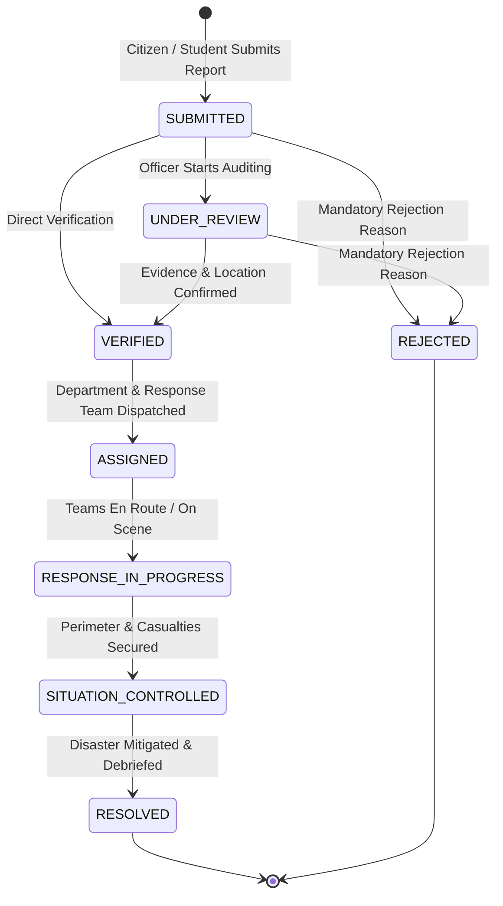

# System Architecture Document
## Disaster Preparedness and Response Education System

### 1. High-Level Architecture Overview
The system follows a modern multi-tiered, service-oriented architecture designed to handle public emergency reporting, real-time crisis triage, agency dispatch, and interactive civil disaster education.

```mermaid
flowchart TD
    subgraph Client Tier [Frontend - React 18 + Vite + MUI]
        STU[Student / Citizen Portal]
        OFF[Government Officer Triage Console]
        ADM[System Administration Hub]
        MAP[Leaflet / OSM GIS Engine]
    end

    subgraph Server & Security [Core Java HTTP Server]
        HTTP[HttpServer - Port 8080]
        SEC[BaseHandler - CORS & JWT Validation Filter]
        HANDLERS[Java Handlers - AuthHandler, ReportHandler, etc.]
    end

    subgraph Core Domain Services [Pure Java Service Layer]
        REP_SVC[Disaster Report & State Machine Service]
        NOTIF_SVC[Multi-Channel Notification Dispatcher]
        EDU_SVC[Curriculum & Preparedness Scorer]
        DEPT_SVC[Agency & Response Team Dispatch Service]
        FILE_SVC[Local File Storage & Metadata Service]
        DASH_SVC[Role-Specific Telemetry Aggregator]
    end

    subgraph Data Access Layer [JDBC DAO Pattern]
        DAO[UserDAO, DisasterReportDAO, DepartmentDAO, etc.]
        POOL[DatabaseConnection - JDBC Driver]
    end

    subgraph Data & Storage Layer
        DB[(MySQL 8.0 Relational Storage)]
        FILES[(Local File System / Evidence Storage)]
    end

    Client Tier -->|REST / HTTP + Bearer JWT| HTTP
    HTTP --> SEC
    SEC --> HANDLERS
    HANDLERS --> REP_SVC
    HANDLERS --> NOTIF_SVC
    HANDLERS --> EDU_SVC
    HANDLERS --> DEPT_SVC
    HANDLERS --> FILE_SVC
    HANDLERS --> DASH_SVC

    REP_SVC --> DAO
    NOTIF_SVC --> DAO
    EDU_SVC --> DAO
    DEPT_SVC --> DAO
    FILE_SVC --> FILES
    FILE_SVC --> DAO
    DASH_SVC --> DAO

    DAO --> POOL
    POOL --> DB
```

---

### 2. Role-Based Access Control (RBAC) Matrix
The application strictly enforces 3 roles without artificial or redundant roles:

| Feature / Resource | STUDENT / CITIZEN | GOVERNMENT_OFFICER | ADMIN |
| :--- | :---: | :---: | :---: |
| Self Registration | Open | Authorized Token Required | Authorized Token Required |
| Educational Modules & Quizzes | Read & Submit | Read-only | Manage & Read |
| Scenario Simulations & Preparedness Score | Participate | View Analytics | View Analytics |
| Submit Disaster Incident Report | Yes (with Photo/Video) | Yes | Yes |
| Public GIS Disaster Map | Verified Incidents | Verified Incidents | All Incidents |
| Incident Verification & Rejection | No | Yes (Mandatory Rejection Reason) | Yes |
| Department & Team Assignment | No | Yes (Restricted to VERIFIED reports) | Yes |
| Lifecycle Status Transitions | No | Yes (State Machine Validated) | Yes |
| User Directory & Access Toggle | No | No | Yes (Full Governance) |
| Agency & Response Unit Setup | No | View Only | Yes (Add Depts/Teams) |

---

### 3. Incident Lifecycle State Machine
Every disaster report undergoes strict deterministic state validation:



---

### 4. Preparedness Assessment Scoring Algorithm
A citizen's Preparedness Score is calculated transparently out of **100 points**:

$$\text{Preparedness Score} = \text{Module Progress Score} (40\%) + \text{Quiz Mastery Score} (40\%) + \text{Simulation Drill Score} (20\%)$$

- **Module Score (40 pts):** $\frac{\text{Completed Modules}}{\text{Total Modules}} \times 40$
- **Quiz Score (40 pts):** $\text{Average Quiz Score} \times 0.40$
- **Simulation Score (20 pts):** $\frac{\text{Passed Drills}}{\text{Total Drills}} \times 20$
- **Preparedness Tiers:**
  - `90 - 100`: **EXEMPLARY**
  - `75 - 89`: **ADVANCED**
  - `50 - 74`: **INTERMEDIATE**
  - `< 50`: **NOVICE**

---

### 5. Notification Dispatch Pipeline
The system utilizes a multi-channel mock and transactional architecture:
- **In-App Alerts:** Persisted in `notifications` table, delivered instantly to recipient user IDs.
- **SMTP Gateway Mock:** Formats professional HTML emergency alert emails with incident identifiers and dispatch links.
- **SMS Gateway Mock:** Generates carrier-compliant SMS text alerts with priority markers and operational instructions.
