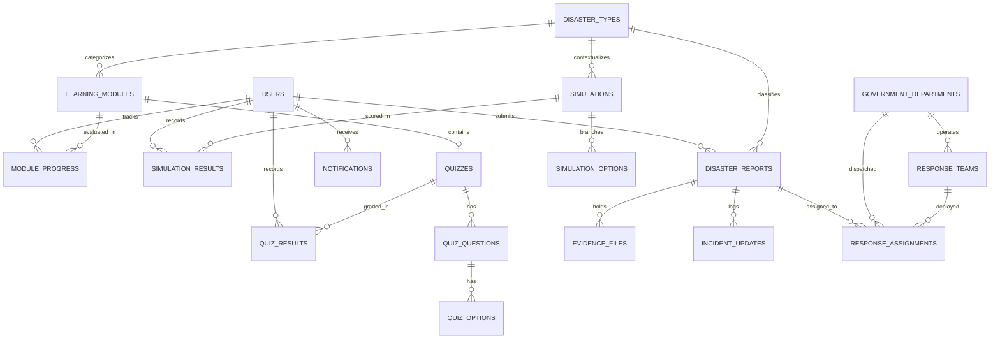

# Database Schema & Data Dictionary
## Disaster Preparedness and Response Education System

### 1. Database Overview
- **Database Engine:** MySQL 8.0 (InnoDB)
- **Character Set:** `utf8mb4`
- **Collation:** `utf8mb4_unicode_ci`
- **Tables Count:** 19 normalized relational tables

---

### 2. Entity Relationship Diagram (ERD)

---

### 3. Key Relational Tables & Attributes

#### `users`
| Column | Type | Constraints | Description |
|---|---|---|---|
| `id` | BIGINT | PK, AUTO_INCREMENT | Unique user account ID |
| `email` | VARCHAR(100) | UNIQUE, NOT NULL | Login email |
| `password_hash` | VARCHAR(255) | NOT NULL | BCrypt hashed password |
| `full_name` | VARCHAR(100) | NOT NULL | Full name of user |
| `phone_number` | VARCHAR(20) | NULL | Contact mobile number |
| `role` | VARCHAR(30) | NOT NULL | `STUDENT`, `GOVERNMENT_OFFICER`, `ADMIN` |
| `status` | VARCHAR(20) | NOT NULL | `ACTIVE`, `INACTIVE`, `SUSPENDED` |
| `badge_number` | VARCHAR(50) | NULL | Government officer identifier |
| `department` | VARCHAR(100) | NULL | Assigned agency |
| `student_id` | VARCHAR(50) | NULL | University student ID |
| `institution` | VARCHAR(100) | NULL | University / Academic school |
| `created_at` | DATETIME | NOT NULL | Creation timestamp |

#### `disaster_reports`
| Column | Type | Constraints | Description |
|---|---|---|---|
| `id` | BIGINT | PK, AUTO_INCREMENT | Incident unique key |
| `report_number` | VARCHAR(50) | UNIQUE, NOT NULL | Human ID: `DR-2026-XXXXXX` |
| `reporter_id` | BIGINT | FK -> users(id) | Citizen/Student author |
| `disaster_type_id` | BIGINT | FK -> disaster_types(id) | Associated hazard type |
| `title` | VARCHAR(200) | NOT NULL | Incident summary |
| `description` | TEXT | NULL | Full field narrative |
| `latitude` | DECIMAL(10, 7) | NOT NULL | GPS latitude |
| `longitude` | DECIMAL(10, 7) | NOT NULL | GPS longitude |
| `address` | VARCHAR(255) | NULL | Reverse-geocoded location |
| `severity` | VARCHAR(20) | NOT NULL | `LOW`, `MEDIUM`, `HIGH`, `CRITICAL` |
| `status` | VARCHAR(30) | NOT NULL | State machine status |
| `casualties_count`| INT | DEFAULT 0 | Fatalities count |
| `injured_count` | INT | DEFAULT 0 | Injured casualties count |
| `trapped_count` | INT | DEFAULT 0 | Civilians trapped |
| `rejection_reason`| TEXT | NULL | Mandatory explanation if rejected |
| `assigned_dept_id`| BIGINT | FK -> departments(id) | Response agency |
| `assigned_team_id`| BIGINT | FK -> teams(id) | Tactical ground unit |

#### `evidence_files`
| Column | Type | Constraints | Description |
|---|---|---|---|
| `id` | BIGINT | PK, AUTO_INCREMENT | File record identifier |
| `report_id` | BIGINT | FK -> disaster_reports(id) | Target incident |
| `file_name` | VARCHAR(255) | NOT NULL | Stored disk filename |
| `original_filename`| VARCHAR(255) | NOT NULL | Original user filename |
| `file_type` | VARCHAR(100) | NOT NULL | MIME Type (`image/jpeg`, etc.) |
| `file_size` | BIGINT | NOT NULL | Size in bytes |
| `file_url` | VARCHAR(500) | NOT NULL | REST retrieval endpoint URL |
| `category` | VARCHAR(50) | NOT NULL | `PHOTO`, `VIDEO`, `DOCUMENT` |

---

### 4. Indexing & Optimization Strategy
- **Spatial Indexing Candidates:** B-Tree composite indexes on `(latitude, longitude)` and `(status, created_at)` enable sub-second map cluster queries.
- **Unique Constraints:** Applied to `users.email`, `disaster_reports.report_number`, and `disaster_types.name`.
- **Foreign Key Cascades:** Strategic `ON DELETE CASCADE` on quiz options and simulation options to maintain data integrity when modifying curricula.
